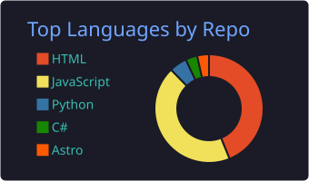
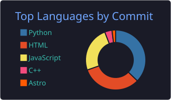
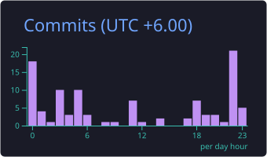

<!-- HEADER -->

<h1 align="center">Minhazul Abedin</h1>

<b>Web Developer &middot; Client Websites &middot; Web Apps &middot; Dhaka</b>

<!-- TYPING SUBTITLE -->

  

<!-- BADGES -->

  
  
  

 

<!-- ABOUT -->
<h2 align="center">👨‍💻 About Me</h2>

I build **websites and web apps** for clients and for my own projects, 
mainly in HTML, CSS, JavaScript, PHP/MySQL and Python, with Leaflet for maps. 
I build with **Claude Code**: I scope the job, direct and review the code, test it, and ship it. 
A few projects were built with React, Next.js or FastAPI.

🔹 Client websites &nbsp;•&nbsp; 🔹 Web apps &nbsp;•&nbsp; 🔹 Interactive maps

<!-- CURRENTLY BUILDING -->
<h2 align="center">🚀 Currently Building</h2>

Concept websites for small businesses in Dhaka (<a href="https://abedinm.github.io/concepts/hanif-biriyani/">example</a>) 
Keeping the <a href="https://abedinm.github.io/dhaka-utilities-map/">Dhaka Utilities Map</a> up to date

<!-- TECH STACK -->
<h2 align="center">🛠️ Tech Stack</h2>

**Web** 

**Tools** 

Built with on some projects: React · Next.js · FastAPI · C# WinForms

<!-- FEATURED PROJECTS -->
<h2 align="center">⭐ Featured Projects</h2>

| Project | What it does | Stack | Live |
|:--|:--|:--|:-:|
| **Deltadesh** | Company website for a Dhaka consultancy | `HTML` `CSS` `JavaScript` | **[Open](https://deltadesh.com/)** |
| **[dhaka-utilities-map](https://github.com/abedinm/dhaka-utilities-map)** | Interactive city map with 13 color-coded utility layers | `Leaflet` `OpenStreetMap` | **[Open](https://abedinm.github.io/dhaka-utilities-map/)** |
| **[concepts](https://github.com/abedinm/concepts)** | Concept websites for local restaurants, clinics and salons | `HTML` `CSS` `JavaScript` | **[Example](https://abedinm.github.io/concepts/hanif-biriyani/)** |
| **[corner-table](https://github.com/abedinm/corner-table)** | Mobile-first restaurant site, installable as a PWA | `JavaScript` `PWA` | — |
| **[codex-tools](https://github.com/abedinm/codex-tools)** | 11 installable PWA tools for university students | `JavaScript` `PWA` | — |
| **[DocAtHome](https://github.com/abedinm/DocAtHome)** | Role-based home healthcare system, full booking + payment flow | `C#` `WinForms` `SQL Server` | Desktop |

More work, with screenshots: **[abedinm.github.io](https://abedinm.github.io/)**

<!-- STATS -->
<h2 align="center">📊 GitHub Stats</h2>

  

  
  

  

<!-- CONTACT -->
<h2 align="center">📫 Connect With Me</h2>

  
  
  

 

<!-- FOOTER -->

